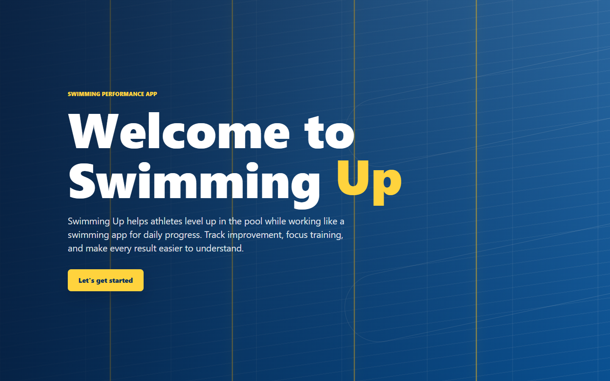
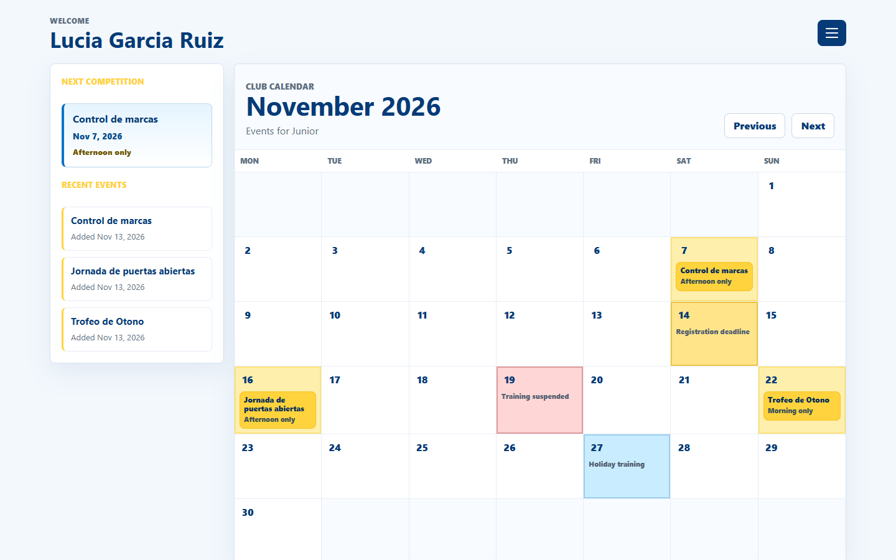
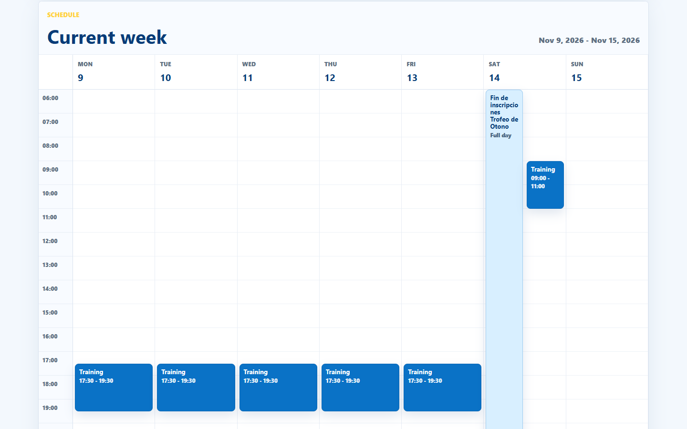
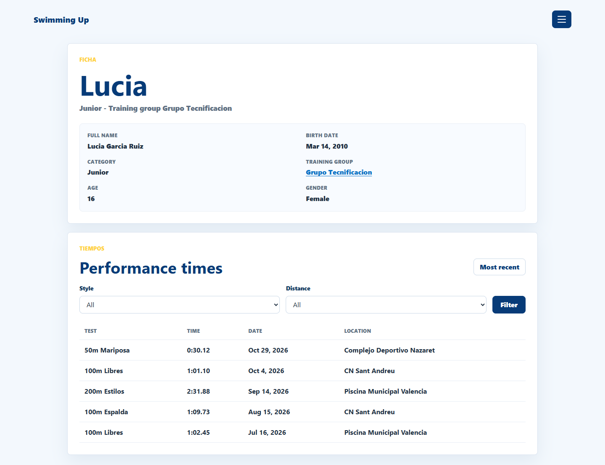
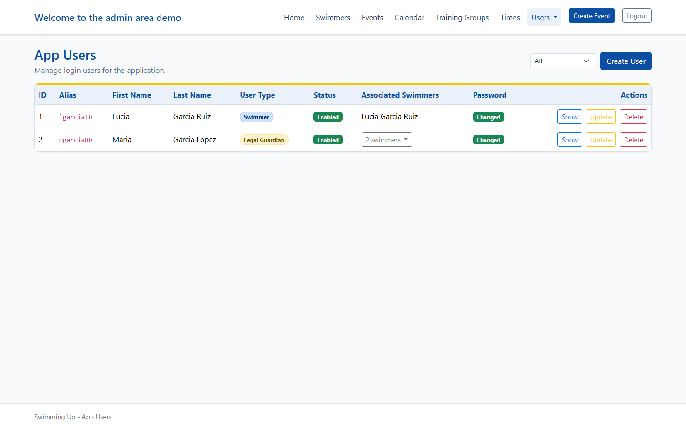
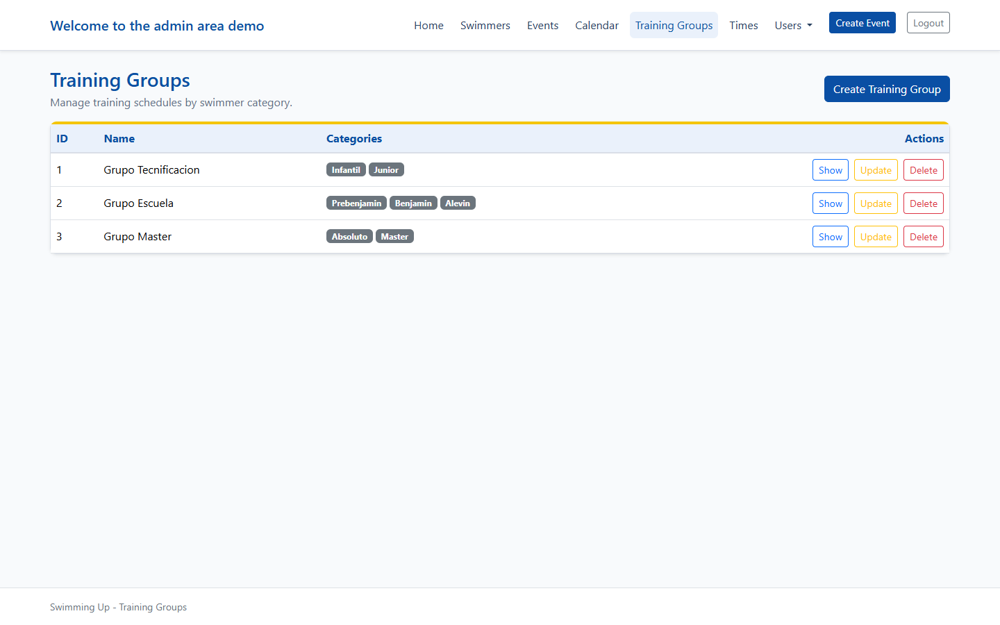
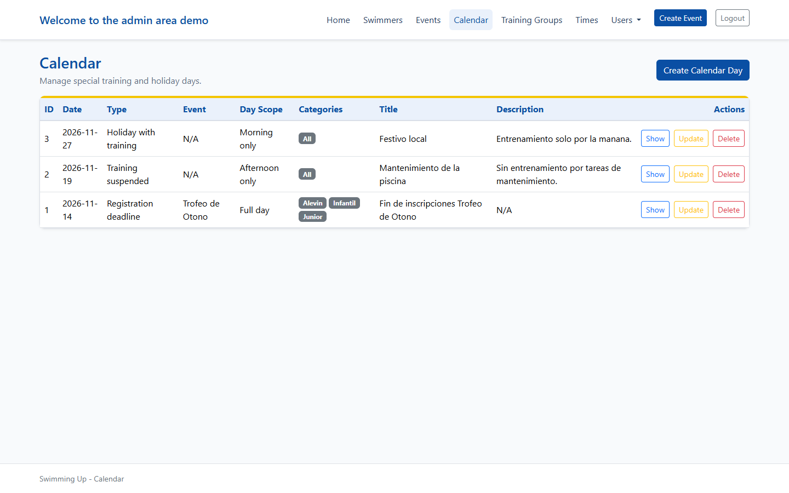
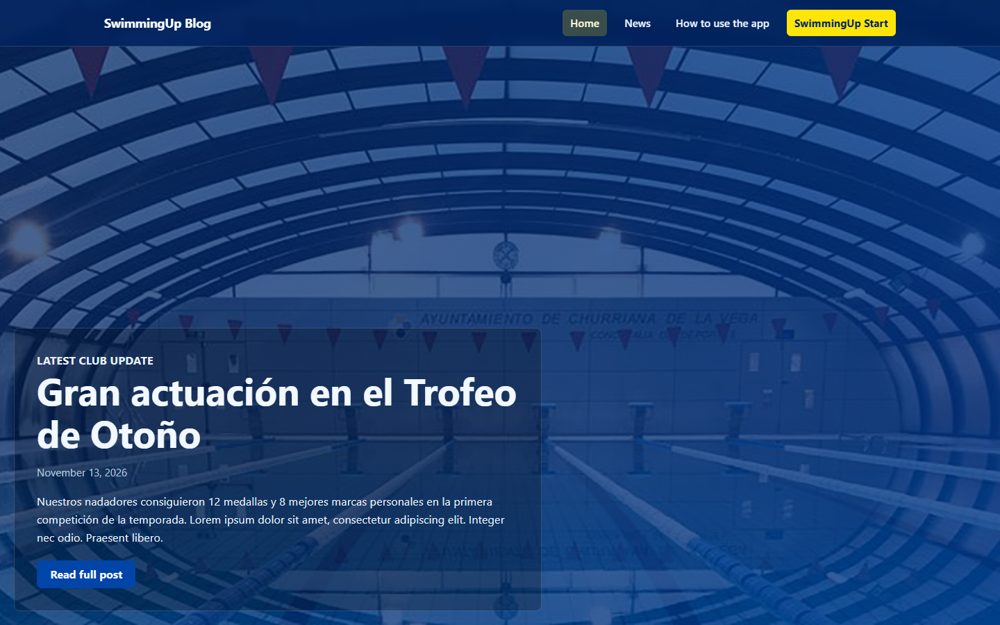
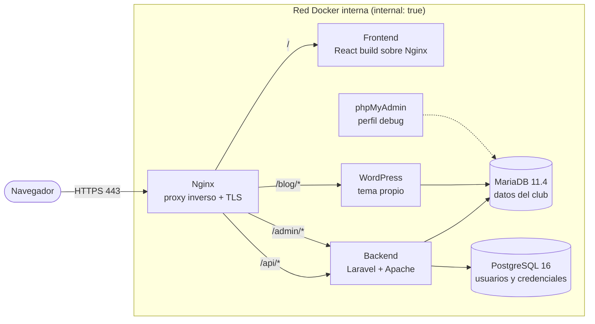
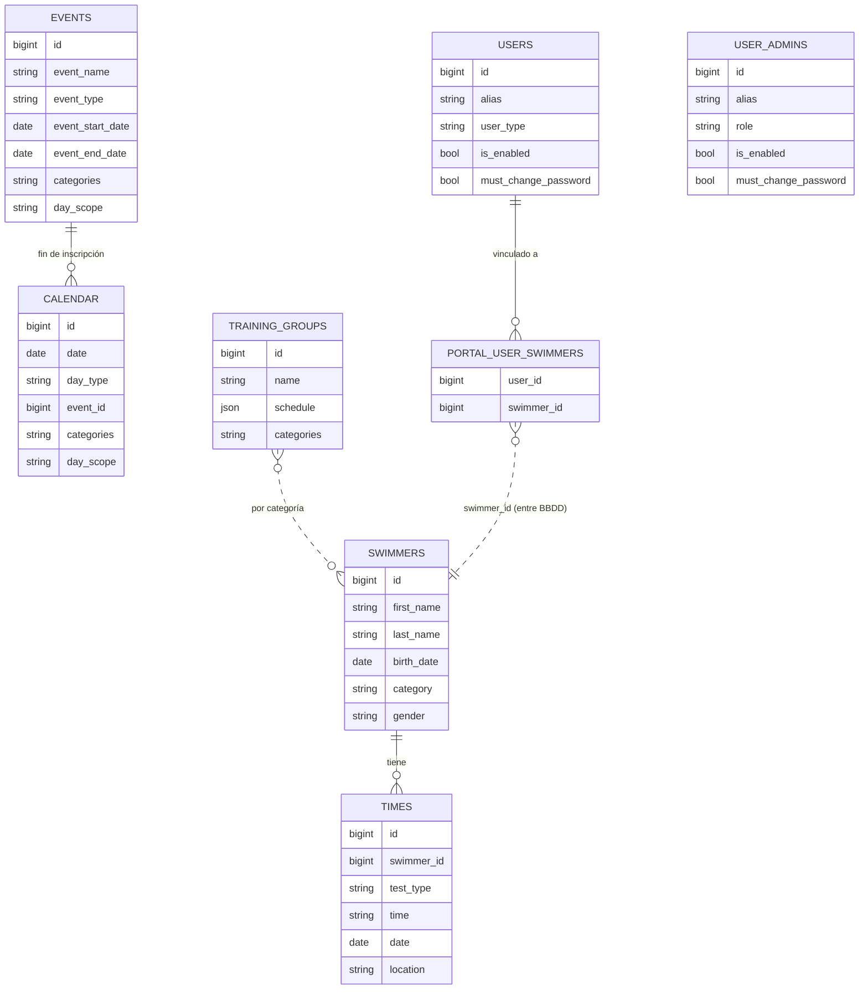

# 🏊 Swimming Up

> **Proyecto Final del Ciclo Formativo de Grado Superior en Desarrollo de Aplicaciones Web (DAW)**
>
> Plataforma web para la gestión de un club de natación: aplicación para nadadores y familias, panel de administración con control de acceso por roles y blog de noticias, todo orquestado con Docker detrás de un proxy inverso Nginx y desplegado en AWS con HTTPS.


---

### 🇬🇧 English summary

**Swimming Up** is my final project for the Spanish *Higher Technical Degree in Web Application Development (DAW)*. It is a multi-service web platform for a swimming club, designed for a real club and built end to end by me in about four weeks:

- **React 19 SPA** for swimmers and legal guardians: monthly calendar, weekly training timetable, personal-best times and multi-profile switching.
- **Laravel 13 admin panel** (Blade) with custom **role-based access control** (root / master / admin), forced password rotation and full CRUD for swimmers, events, calendar, times, training groups and users.
- **Two databases on purpose**: MariaDB for club data, PostgreSQL for identities and credentials, both handled from Laravel through two connections.
- **WordPress** with a custom theme served under `/blog` on the same domain.
- **Seven Docker containers** behind an **Nginx reverse proxy** with path-based routing, an isolated internal network, multi-stage production images, and **Let's Encrypt TLS**, deployed on an **AWS EC2 (Ubuntu)** instance.

The rest of this document is in Spanish.

---

## 📑 Índice

1. [Contexto del proyecto](#-contexto-del-proyecto)
2. [Capturas](#-capturas)
3. [Arquitectura](#-arquitectura)
4. [Infraestructura y DevOps](#-infraestructura-y-devops)
5. [Backend (Laravel)](#-backend-laravel)
6. [Modelo de datos](#-modelo-de-datos)
7. [Frontend (React)](#-frontend-react)
8. [Blog (WordPress)](#-blog-wordpress)
9. [Puesta en marcha en local](#-puesta-en-marcha-en-local)
10. [Despliegue en producción](#-despliegue-en-producción)
11. [Tests](#-tests)
12. [Flujo de trabajo](#-flujo-de-trabajo)
13. [Limitaciones conocidas y mejoras futuras](#-limitaciones-conocidas-y-mejoras-futuras)
14. [Autor](#-autor)

---

## 🎓 Contexto del proyecto

Swimming Up es el **Proyecto Final del CFGS de Desarrollo de Aplicaciones Web (DAW)**. Lo diseñé para las necesidades de un club de natación real, aunque todavía no está en uso por el club:

| Necesidad del club | Solución |
|---|---|
| Los nadadores y familias no saben qué días hay entreno, competición o festivo | Calendario mensual y horario semanal filtrados por la categoría del nadador |
| Las marcas de los nadadores están dispersas | Historial de tiempos por prueba, estilo y distancia |
| Un padre o madre puede tener varios hijos en el club | Usuario *tutor legal* con selector de perfil |
| Varios entrenadores gestionan datos, con distintos permisos | Panel de administración con roles y permisos |
| El club necesita publicar noticias | Blog WordPress con tema propio, bajo el mismo dominio |

El alcance cubre todo el ciclo: análisis, modelado de datos, backend, frontend, CMS, contenedores, proxy inverso, despliegue en la nube y certificados TLS.

---

## 📸 Capturas

> Capturas del entorno local con los datos ficticios de [`DemoSeeder`](backend/database/seeders/DemoSeeder.php).



**App para nadadores y familias (React)**

| Calendario mensual | Horario semanal del grupo | Perfil y marcas |
|---|---|---|
|  |  |  |

**Panel de administración (Laravel + Blade) y blog (WordPress)**

| Usuarios de la app | Grupos de entrenamiento | Calendario |
|---|---|---|
|  |  |  |

<p align="center"></p>

---

## 🏗 Arquitectura

Todo el sistema vive bajo **un único dominio**. Nginx es el único punto de entrada y enruta por prefijo de ruta hacia cada contenedor:



| Ruta | Servicio | Descripción |
|---|---|---|
| `/` · `/login` · `/app/*` | `frontend` | SPA React para nadadores y tutores |
| `/api/*` | `backend` | API JSON de Laravel consumida por React |
| `/admin/*` | `backend` | Panel de administración Blade |
| `/blog/*` | `wordpress` | Blog y noticias del club |
| `/health` | `nginx` | Healthcheck del proxy |
| `/phpmyadmin/` | `phpmyadmin` | Solo en desarrollo o con `--profile debug` |

### Decisiones técnicas destacadas

- **Un dominio, varios servicios.** Laravel y WordPress se sirven bajo un prefijo (`/admin`, `/blog`). Nginx reescribe la ruta y envía `X-Forwarded-Prefix`; Laravel lo procesa con `trustProxies()` y WordPress reconstruye `REQUEST_URI` en `WORDPRESS_CONFIG_EXTRA`. Así cada aplicación genera bien sus URLs y las cookies quedan acotadas a su ruta (`COOKIEPATH=/blog/`).
- **Separación de datos por responsabilidad.** Los datos del club (nadadores, eventos, calendario, marcas) van en **MariaDB**. Las identidades y contraseñas van en **PostgreSQL**, aisladas del resto. Laravel usa dos conexiones (`mariadb` y `auth_pgsql`) y cada modelo declara la suya.
- **Upstreams resueltos en tiempo de ejecución.** Nginx usa el DNS interno de Docker (`resolver 127.0.0.11`) con `proxy_pass` a variables. Así el proxy arranca aunque un contenedor de destino aún no esté listo.

---

## 🐳 Infraestructura y DevOps

El proyecto tiene **dos entornos con ficheros Compose distintos**:

| | Desarrollo (`compose.yaml`) | Producción (`compose.prod.yaml`) |
|---|---|---|
| Frontend | Servidor Vite con HMR (`node:22-alpine`) | **Build multi-stage**: Node compila → Nginx sirve estáticos con caché de 30 días |
| Backend | `php artisan serve --no-reload` (`php:8.4-cli-alpine`) con código montado; `--no-reload` hace que el servidor use las variables de Compose | **Apache + PHP 8.4**, dependencias con `composer install --no-dev --optimize-autoloader` |
| Proxy | HTTP en puerto 80 | HTTP → **HTTPS** (redirección 301), TLS 1.2/1.3, Let's Encrypt |
| Red interna | Red bridge | Red con **`internal: true`**: sin salida a Internet ni puertos publicados |
| phpMyAdmin | Accesible en `/phpmyadmin/` | Solo con `--profile debug` y enlazado a `127.0.0.1` |
| Reinicio | — | `restart: unless-stopped` en todos los servicios |

### Detalles de las imágenes

- **Caché de capas en el backend:** se copian primero `composer.json` y `composer.lock` y se instalan las dependencias. Después se copia el código, así un cambio en el código no reinstala las dependencias.
- **Entrypoint del backend en producción** ([`docker/backend/entrypoint.prod.sh`](docker/backend/entrypoint.prod.sh)):
  - prepara `storage/` y `bootstrap/cache` con los permisos de `www-data`;
  - **aborta el arranque si falta `APP_KEY`** en producción;
  - ejecuta `package:discover`;
  - opcionalmente lanza las migraciones (`RUN_MIGRATIONS=true`).
- **Entrypoint de WordPress** ([`docker/wordpress/entrypoint.sh`](docker/wordpress/entrypoint.sh)): sincroniza las credenciales de BD de `wp-config.php` con las variables de entorno en cada arranque. Así se pueden rotar contraseñas sin entrar al contenedor.
- **Inicialización de MariaDB** ([`database/mariadb/init/`](database/mariadb/init/01-create-wordpress-db.sh)): un script crea la base de datos y el usuario de WordPress, con privilegios limitados a esa base.
- **Volúmenes con nombre** para la persistencia de MariaDB, PostgreSQL, el storage de Laravel y los *uploads* de WordPress. El tema de WordPress se monta **en solo lectura** en producción.

### Despliegue realizado

La aplicación se desplegó en una instancia **AWS EC2 con Ubuntu**:
- dominio dinámico `swimmingup.hopto.org` (No-IP);
- certificado **Let's Encrypt** (clave ECDSA) obtenido con **Certbot** mediante el desafío *webroot*, que Nginx sirve en `/.well-known/acme-challenge/`.

> ℹ️ El despliegue público no está activo actualmente. La sección [Despliegue en producción](#-despliegue-en-producción) explica cómo reproducirlo.

---

## ⚙ Backend (Laravel)

Laravel 13 sobre PHP 8.4 cumple dos papeles: **panel de administración** server-side con Blade y **API JSON** para el frontend React.

### Control de acceso basado en roles (RBAC)

Implementé la autenticación del panel desde cero con **dos middleware propios** registrados como alias en [`bootstrap/app.php`](backend/bootstrap/app.php):

- [`admin.auth`](backend/app/Http/Middleware/AdminAuthenticate.php) valida la sesión, comprueba que el usuario sigue existiendo y está habilitado, y **obliga a cambiar la contraseña** si `must_change_password` está activo.
- [`admin.can:<permiso>`](backend/app/Http/Middleware/AdminAuthorize.php) consulta `UserAdmin::canAccess()` y devuelve `403` si el rol no tiene ese permiso.

```php
Route::middleware(['admin.auth', 'admin.can:manage-swimmers'])->group(function () {
    Route::get('/swimmers', [SwimmerController::class, 'index']);
    // ...
});
```

| Permiso | `root` | `master` | `admin` |
|---|:-:|:-:|:-:|
| Eventos, calendario, marcas, grupos de entrenamiento | ✅ | ✅ | ✅ |
| Nadadores | ✅ | ✅ | ❌ |
| Usuarios de la app | ✅ | ✅ | ❌ |
| Ver administradores | ✅ | ✅ | ❌ |
| Crear, editar, activar/desactivar administradores | ✅ | ❌ | ❌ |
| Eliminar administradores · resetear contraseñas | ✅ | ❌ | ❌ |

La base de datos refuerza estas reglas:
- un **índice único parcial** en PostgreSQL garantiza que **solo exista un `root`**: `CREATE UNIQUE INDEX ... ON user_admins ((role)) WHERE role = 'root'`;
- una restricción `CHECK` limita los valores de `role`.

### Lógica de negocio destacada

- **Alta automática de cuentas:** al crear un nadador, se genera en una transacción su usuario de la app en PostgreSQL. La cuenta solo queda **habilitada si el nadador tiene 16 años o más**; si es menor, accede a través de su tutor legal.
- **Generación de alias únicos** ([`PortalUserAlias`](backend/app/Models/PortalUserAlias.php)): inicial del nombre + primer apellido + dos últimas cifras del año de nacimiento, normalizado a ASCII (`Lucía García` de 2010 → `lgarcia10`). Si el alias ya existe, prueba con el segundo apellido y después añade un sufijo numérico.
- **Política de contraseñas:**
  - mínimo 8 caracteres, al menos una mayúscula y un carácter especial;
  - cambio obligatorio en el primer acceso, tanto en el panel como en la app;
  - hash con bcrypt mediante el *cast* `hashed` de Eloquent.
- **Horarios de entrenamiento en JSON:**
  - cada grupo guarda varios bloques `{days, from, to}` en una columna JSON;
  - el modelo [`TrainingGroup`](backend/app/Models/TrainingGroup.php) los convierte en texto legible y detecta rangos de días contiguos (`M-F (Lunes a viernes): 17:30 a 19:30`).
- **Calendario con reglas de validación condicionales:**
  - las fechas son únicas;
  - el día de tipo *fin de inscripción* exige un evento asociado (`Rule::requiredIf`);
  - las categorías se normalizan (si se marcan todas, se guarda `All`).

### Migraciones con transformación de datos

El esquema cambió durante el desarrollo, y las migraciones **transforman los datos existentes en vez de borrarlos**:

- `age` → `birth_date`: calcula una fecha a partir de la edad (`MAKEDATE`) y tiene un `down()` reversible con `TIMESTAMPDIFF`.
- Rellena los alias de los usuarios existentes y crea la tabla pivote `portal_user_swimmers` a partir de la relación 1:1 anterior.
- Reestructura `user_admins`: migra a alias y roles, crea el usuario `root` inicial y elimina las columnas obsoletas.
- Las migraciones de PostgreSQL declaran `protected $connection = 'auth_pgsql'`.

### API REST para el frontend

| Método | Endpoint | Descripción |
|---|---|---|
| `GET` | `/api/health` | Estado del servicio |
| `POST` | `/api/front/login` | Login por alias + contraseña |
| `POST` | `/api/front/change-password` | Cambio de contraseña (obligatorio en el primer acceso) |
| `GET` | `/api/front/app-data?user_id&month&swimmer_id` | Datos agregados en una sola respuesta: perfil, nadadores vinculados, eventos, calendario, marcas y grupo de entrenamiento |

`app-data` reúne en **una sola petición** datos de las dos bases de datos:
- **eventos** que se solapan con el mes pedido o con la semana actual (`COALESCE` sobre fechas de inicio y fin);
- **días de calendario** del mismo intervalo, filtrados por la categoría del nadador;
- **marcas** del nadador seleccionado;
- **grupo de entrenamiento** que le corresponde.

---

## 🗄 Modelo de datos



- **MariaDB** guarda `swimmers`, `times`, `events`, `calendar`, `training_groups` y, en otra base, WordPress.
- **PostgreSQL** guarda `users` (usuarios de la app), `portal_user_swimmers` y `user_admins`.
- La relación entre `portal_user_swimmers.swimmer_id` y `swimmers.id` cruza de motor. No puede tener clave foránea, así que **la aplicación mantiene la integridad** al crear, editar o borrar.

---

## ⚛ Frontend (React)

SPA con **React 19 + Vite 6**, sin librerías de UI ni de enrutado: el router está hecho con la History API y el CSS es propio.

- **Flujo de autenticación por estados:** `login` → `cambio de contraseña obligatorio` → `selección de perfil` (solo tutores) → `app`. La sesión se guarda en `localStorage`.
- **Calendario mensual:** fusiona eventos de varios días con los días especiales (festivos, entrenos suspendidos, fin de inscripciones, cambios de horario).
- **Horario semanal:**
  - pinta los bloques del grupo de entrenamiento sobre una rejilla horaria;
  - superpone eventos y días especiales según su franja (mañana, tarde o día completo);
  - apila los bloques que se solapan.
- **Marcas personales:** filtros por estilo y distancia (las extrae del texto de la prueba, p. ej. `100m Libres`) y orden por tiempo o fecha.
- **Perfiles múltiples:** un tutor legal cambia entre sus nadadores y toda la app se recarga con el nadador elegido.
- **Configuración por entorno:** la URL de la API llega por `VITE_API_BASE_URL` como *build arg* de Docker.

---

## 📰 Blog (WordPress)

WordPress 6.5 con un **tema propio** ([`wordpress/wp-content/themes/swimmingup`](wordpress/wp-content/themes/swimmingup)):

- plantillas `front-page`, `home`, `single`, `page` y la plantilla de página *News Page*;
- consultas personalizadas con `WP_Query`: últimas noticias, destacadas y relacionadas;
- **los usuarios pueden borrar sus propios comentarios** mediante un *handler* propio protegido con *nonce* (`check_admin_referer`) y con comprobación de propiedad;
- se sirve bajo `/blog` en el mismo dominio y la cookie se limita a esa ruta.

---

## 🚀 Puesta en marcha en local

**Requisitos:** Docker y Docker Compose.

```bash
git clone https://github.com/alexbaaaa/Final-Project-DAW.git
```

```bash
cd Final-Project-DAW && cp .env.example .env
```

Edita `.env` y cambia las contraseñas `change_me_*`. Después:

```bash
docker compose up -d --build
```

```bash
docker compose exec backend composer install
```

```bash
docker compose exec backend php artisan migrate
```

Opcional: carga los datos de demostración (nadadores, eventos, calendario, marcas y usuarios ficticios):

```bash
docker compose exec backend php artisan db:seed --class=DemoSeeder
```

| Servicio | URL |
|---|---|
| App React | http://localhost/ |
| Panel admin | http://localhost/admin/ |
| Blog | http://localhost/blog/ |
| phpMyAdmin | http://localhost/phpmyadmin/ |

Las credenciales de demo están documentadas en [`DemoSeeder.php`](backend/database/seeders/DemoSeeder.php). La migración crea un usuario `root` con contraseña temporal `1234`, que hay que cambiar en el primer acceso.

---

## 🌐 Despliegue en producción

Guía probada en **Ubuntu sobre AWS EC2**. En producción solo Nginx expone puertos (80/443).

1. Instalar Docker Engine y el plugin Compose, y clonar el repositorio.
2. Crear el fichero de entorno y rellenarlo:
   ```bash
   cp .env.production.example .env.production
   ```
   - cambiar todas las contraseñas `change_me_*`;
   - revisar el dominio en `APP_URL`, `WP_HOME`, etc.;
   - generar `APP_KEY`:
     ```bash
     printf 'base64:%s\n' "$(openssl rand -base64 32)"
     ```
3. Obtener el certificado TLS con Certbot (*webroot* en `docker/nginx/certbot/www`, configuración en `docker/nginx/letsencrypt`).
4. Construir y levantar:
   ```bash
   docker compose -f compose.prod.yaml --env-file .env.production up -d --build
   ```
5. Ejecutar las migraciones, o arrancar con `RUN_MIGRATIONS=true`:
   ```bash
   docker compose -f compose.prod.yaml --env-file .env.production exec backend php artisan migrate --force
   ```

<details>
<summary><b>Comandos útiles de operación</b></summary>

```bash
# Estado de los contenedores
docker compose -f compose.prod.yaml --env-file .env.production ps

# Logs del backend / proxy
docker compose -f compose.prod.yaml --env-file .env.production logs --tail=200 backend
docker compose -f compose.prod.yaml --env-file .env.production logs --tail=200 nginx

# Limpiar cachés de Laravel tras cambiar configuración
docker compose -f compose.prod.yaml --env-file .env.production exec backend php artisan optimize:clear

# Recrear servicios tras cambiar variables
docker compose -f compose.prod.yaml --env-file .env.production up -d --force-recreate backend nginx

# phpMyAdmin temporal (solo en 127.0.0.1, acceder por túnel SSH)
docker compose -f compose.prod.yaml --env-file .env.production --profile debug up -d phpmyadmin
```
</details>

---

## 🧪 Tests

Tests con PHPUnit 12 sobre la lógica de los grupos de entrenamiento:

- **Unit:** el formateo de horarios agrupa los días contiguos (`M-F`, `T-Th`, días sueltos).
- **Feature:** crear y editar un grupo guarda varios bloques horarios en un solo registro, sin crear duplicados.

```bash
docker compose exec backend php artisan test
```

---

## 🔀 Flujo de trabajo

- **Git Flow simplificado:** ramas `feature/*`, `fix/*` y `develop`, integradas en `main` mediante **18 pull requests** en GitHub.
- **Conventional Commits** (`feat:`, `fix:`, `chore:`...) con plantilla en [`.gitmessage`](.gitmessage).
- **Desarrollo incremental en unas 4 semanas** (mayo–junio 2026): estructura Docker → enrutado del proxy → WordPress → Laravel → React → despliegue en EC2 con HTTPS.

---

## 🧭 Limitaciones conocidas y mejoras futuras

Es un proyecto académico, y antes de usarlo en un club real habría que resolver estos puntos:

| Área | Situación actual | Mejora prevista |
|---|---|---|
| Autenticación de la API | `/api/front/*` identifica al usuario por `user_id` en la petición y la sesión se guarda en `localStorage` | Tokens con **Laravel Sanctum** y endpoints protegidos con middleware |
| Endpoint de usuarios | `/api/front/users` no requiere autenticación | Eliminarlo o restringirlo a administradores |
| Contraseña inicial | Es el propio alias (con cambio obligatorio) | Contraseña aleatoria o enlace de activación por correo |
| Categorías | Texto separado por comas en eventos, calendario y grupos | Tabla `categories` con tablas pivote |
| Renovación TLS | Certbot manual | Contenedor Certbot con renovación programada |
| CI/CD | Sin pipeline | GitHub Actions: tests, lint, build de imágenes y despliegue |
| Cobertura de tests | Centrada en los grupos de entrenamiento | Tests de RBAC, API y flujos de autenticación |
| Idioma | Mezcla de inglés y español en la interfaz | i18n con los ficheros de idioma de Laravel y React |

---

## 👤 Autor

**Alejandro Aguilera López**: Técnico Superior en Desarrollo de Aplicaciones Web (DAW)

- GitHub: [@alexbaaaa](https://github.com/alexbaaaa)

Proyecto distribuido bajo licencia [MIT](LICENSE).
